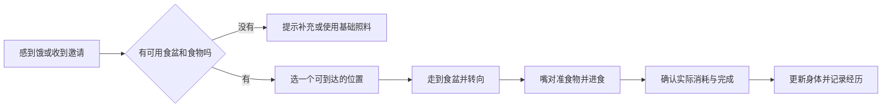

# 丸宠功能设计重构方案

> 本文件为重构方案。2026-10-29 后续实现进度见 [第一轮实现说明](04-implementation.md)，不应把方案中的目标当成已交付功能。
日期：2026-10-29。状态：设计提案，尚未实施。

本篇说明每项功能怎样开始、怎样结束、会改变什么，以及出错后怎么处理。产品方向见[产品方案](01-product-design.md)，代码组织与工作流见[技术方案](03-technical-design.md)。

## 1. 全部功能使用同一份宠物档案

每只宠物由六部分组成。聊天、行动和生成内容都必须知道自己服务的是哪只宠物。

| 部分 | 通俗解释 | 举例 | 变化方式 |
| --- | --- | --- | --- |
| 身份 | 它始终是谁 | 宠物 ID、主人、名字、物种 | ID 不随外观、模型或房间变化 |
| 画像 | 它大体是怎样的伙伴 | 胆子小、好奇、说话简短、偏爱安静 | 创建时确定；主人可调整部分设定，保留版本 |
| 身体 | 它此刻有什么需要 | 饥饿、疲劳、饮水需求、排泄需求、清洁度 | 随时间和实际行动变化 |
| 心情 | 它此刻的感受 | 放松、兴奋、紧张、烦躁 | 根据身体、环境与经历缓慢变化 |
| 记忆与习惯 | 它经历过什么、学会了什么 | 喜欢窗边、记得一起看过书 | 从可信来源产生，允许查看、纠正和忘记 |
| 身体资源 | 画面里如何呈现它 | 模型/精灵、动作、表情、配饰 | 版本化替换；不会自动改掉画像和记忆 |

**身体状态、心情、长期性格分开。** 一次没吃饭会饿，不代表它的性格永久变成暴躁；一次摸头开心，也不意味着长期亲密关系突然满级。

第一版允许一个账号只展示一只宠物，但所有新功能按宠物 ID 工作。未来新建第二只宠物时，画像、记忆、生活状态分别建立。复制外观不复制私人聊天与记忆。

## 2. 领养与 AI 创建宠物

入口：首次使用，以及后续“创作 → 宠物”。

1. 选择基础宠物，或者描述希望的外观。
2. 展示可支持的身体模板，例如先支持四足猫；选择性格倾向和交流方式。
3. 生成外观预览，展示走路、吃饭、坐卧等实际可用动作。静态立绘不能通过最终验收。
4. 命名并确认创建，保存独立身份与画像。
5. 进入已有基本食盆、水、床和厕所的家园，完成第一次互动。

外观生成慢时可先使用明确标注的临时外观；生成失败不影响已创建宠物的记忆。正式外观通过检查后再替换，并允许恢复上一版。

换装、换毛色是在同一个身份上更新外观；领养新宠物会创建新身份。两个按钮在界面和存档上都必须分开。

验收：改名、换外观、切换模型供应商后，宠物仍能召回自己的记忆；未通过身体或动作检查的资源不能直接进入正式家园。

## 3. 身体需求与日常照顾

所有数值用于虚拟玩法，不模拟真实动物医疗。用户默认看到“有点饿”“想休息”等描述，详细数值可在状态页查看。

| 需求 | 触发与表现 | 满足方式 | 关联影响 |
| --- | --- | --- | --- |
| 饥饿 | 找食盆、看向主人、简短提示 | 进食 | 食物减少，饥饿降低，之后逐渐产生排泄需求 |
| 饮水 | 寻找水碗 | 喝水 | 水量减少，饮水需求降低；需要时进入如厕流程 |
| 疲劳 | 动作放慢、打哈欠、寻找床 | 休息、睡觉 | 精力恢复，减少自主探索 |
| 排泄 | 寻找厕所；不通过弹窗催促 | 使用猫砂盆或对应物种设施 | 排泄需求下降，设施清洁度下降 |
| 清洁 | 回避很脏的位置，出现简短说明 | 清理设施、适用的梳洗 | 恢复环境舒适度 |
| 好奇与无聊 | 看、闻、走动、找玩具 | 探索、玩耍、看书 | 获得刺激，形成偏好或小经历 |
| 社交与安全感 | 靠近、回应，也可能退开 | 适量陪伴、安静空间 | 影响心情与下一次选择 |

### 3.1 吃饭必须完成的全过程

规则如下：

- 背包食物与碗中食物分开：补粮把背包中的食物转入碗中，宠物进食再消耗碗中余量。
- 一次进食先预留一份，防止两台设备或两只宠物同时吃掉最后一份。
- 到达并开始实际进食后才消耗；如果路上被挡住，释放预留，不扣粮。
- 已吃下一部分再被打断，只结算已消耗的部分；完成条件与具体分段由活动模板定义。
- 生活记录说明“吃了一些”或“吃好了”，与实际结果一致。
- 基础照料提供不依赖付费的兜底食物，来源单独记录，不能凭空增加用户的背包库存。

验收例子：背包有 3 份，往碗里加 1 份后，背包是 2、碗是 1；重复发送同一次补粮请求，仍是 2 和 1。吃完后碗为 0，同时降低饥饿。途中失败则碗保持 1。

### 3.2 如厕与清理

排泄需求逐步积累，不在每次吃完饭后立刻强制播放一次。它会寻找可达、干净且适合身体大小的设施；如厕动作完成后记录一次设施使用，生成可清理的脏污状态。

清理是一个真实操作。用户点清理后有简短反馈，服务端确认设施恢复；重试不能重复消耗清洁用品或重复发奖励。第一版建议基础清理不消耗付费道具。

设施被移走、占用或不可达时，优先寻找替代位置。离线很久或设施全部不可用时，由基础照料兜底，避免把游戏变成惩罚。可爱排泄图形可关闭，需求与清洁逻辑继续运行。

### 3.3 睡眠与打扰

睡眠分为就位、入睡、睡眠中、醒来。聊天可以得到简短回应，但不会因为每条消息都强制播放完整起床动作。轻触可能只动耳朵；持续打扰增加紧张，宠物可以退开。

“暂停自在活动”和“减少动态效果”分别设置。前者控制是否自主选新活动，后者只减少画面移动与动画，不应让吃饭、睡觉等生活逻辑停摆。

## 4. 自主选择与统一动作进度

### 4.1 它如何决定做什么

按下面顺序选择：

1. 紧急身体需求与必须结束的当前动作。
2. 当前环境中真实存在、可到达、身体能够完成的活动。
3. 主人的邀请、宠物性格、心情、偏好与相关记忆。
4. 避免连续重复，在合理候选中选择。

普通吃睡与避障用可靠规则即可。需要解释邀请、选择有意义的活动或组织一天经历时，再使用 LLM。不会每走一步或每过一秒都调用模型。

正在吃饭时收到“来陪我”，可回答“我先吃完这几口”。邀请设有效期，稍后重新判断；不能在用户离开很久后突然执行过期请求。

### 4.2 全部活动统一使用的进度

| 进度 | 用户理解 | 是否已经产生结果 |
| --- | --- | --- |
| 请求中 | 正在问它愿不愿意 | 否 |
| 接受 / 拒绝 / 稍后 | 已作出选择 | 接受也未完成 |
| 走向目标 | 正在过去 | 通常只预留物品 |
| 就位 | 找好站位和朝向 | 否 |
| 使用中 | 正在吃、读、玩或如厕 | 可按活动阶段结算部分结果 |
| 完成 | 确实做完了 | 只结算一次，并产生经历 |
| 中断 / 受阻 / 取消 | 没完成或只做了一部分 | 按已发生部分结算，释放剩余预留 |

这里新增“走向目标、就位、使用中”，补上当前 `started` 粒度过粗的问题。当前代码在发起走路后就发开始回执，不能据此判断已经开始吃饭。

点地面、点物件、聊天邀请与离线生活，最终都进入同一套活动流程。界面不能各自创建一个看起来相同但规则不同的“吃饭”。

## 5. 心情、性格与长期关系

心情先使用少量维度：愉悦程度、活跃程度、安全感。对外展示平静、好奇、开心、困倦、紧张、想独处等容易理解的词。

| 事件 | 短期影响 | 长期影响 |
| --- | --- | --- |
| 在喜欢的位置睡饱 | 放松、恢复精力 | 多次重复后略微加强地点偏好 |
| 主人适时陪玩 | 开心、活跃 | 逐渐增加对这种互动的信任 |
| 连续打扰睡眠 | 警觉、想退开 | 多次且持续才调整互动偏好；一次不会永久记仇 |
| 第一次见到新玩具 | 好奇，也可能谨慎 | 实际使用后再形成喜欢或不喜欢的记录 |
| 长时间没有登录 | 按生活状态平缓变化 | 不把缺席自动解释为抛弃 |

所有变化有限度、会衰减、能解释来源。模型可以把“紧张且疲劳”表达成自然语言，但不能随意把关系数值写成满级。性格通过一连串选择体现，不能只存在于一段提示词里。

## 6. 记忆系统怎样服务生活

### 6.1 记什么

| 类别 | 保存内容 | 允许来源 | 使用场景 |
| --- | --- | --- | --- |
| 设定与身份 | 名字、物种、主人确认的角色设定 | 创建与明确编辑 | 所有对话和行为 |
| 主人信息 | 喜欢怎样相处、明确告知的偏好 | 用户陈述；敏感内容需明确记忆意愿 | 对话、相关邀请 |
| 共同经历 | 某次读书、完成的旅行、一起玩过什么 | 已确认的行动与旅行事件 | 回忆、话题、后续选择 |
| 宠物习惯 | 常去的位置、喜欢的玩具 | 多次真实选择与使用 | 自主生活 |
| 空间知识 | 碗在哪里、哪个位置被挡住 | 当前家园数据 | 寻路和选择目标，不依赖向量相似度猜位置 |
| 对话上下文 | 最近谈到的内容 | 最近有效聊天 | 接续当前话题，不全部永久保存 |

### 6.2 从经历到记忆的完整过程

实际事件发生 → 保存来源 → 判断是否值得记住 → 提炼简短内容 → 合并或更新旧事实 → 在聊天与行为中按需要取用。

例如，第一次睡窗边只产生一条经历。多次主动选择窗边后，可以形成“偏爱窗边休息”的习惯。一次被主人强行邀请到窗边，不足以证明它喜欢那里。

宠物自己说出的故事、AI 画出来的旅行、未完成的动作，都不能变成已经发生的真实经历。图片默认沿用现有隐私规则：看图推断不自动进入长期记忆。要补充记忆，应由用户用文字明确确认。

### 6.3 查看、纠正与忘记

回忆页让用户看到内容、来源和时间。个人信息可以编辑；已完成的游戏事件可以从陪伴记忆中隐藏或忘记，但不能靠修改记忆倒退库存和奖励账本。

忘记必须同时影响未来聊天、自主选择、画像摘要和检索缓存。旧任务稍后完成，也不能把内容重新写回来。删除原始事件产生的记忆时，保留“不再重新提炼”的标记；向量库暂时不可用，也先在业务层停止使用。

“删除这段聊天”“忘记这件事”“删除作品”分别说明影响范围，不能用一个含糊的删除按钮代表三种操作。

验收：宠物 A 的记忆不能出现在 B 的检索和行为中；用户纠正偏好后，下一轮对话与下一次相关行动都使用新版本；已有模型任务不能带回旧事实。

## 7. 聊天与画面一起工作

聊天输入支持文字、图片，语音先转成可编辑草稿，再由用户发送。语音识别失败时保留文字输入；具体识别服务需要独立完成真实设备验收。

回复前读取：当前宠物画像、有效记忆、真实身体与心情、正在做的活动、当前可用物件。邀请动作后，用活动结果更新聊天卡片，不靠模型自己猜进度。

| 用户说 | 期待行为 |
| --- | --- |
| “你饿了吗？” | 根据真实状态回答；必要时提议或自主选择进食 |
| “来这边” | 发出位置邀请；按心情与当前活动决定 |
| “我们昨天看了什么？” | 检索对应经历；没记录时坦白不确定 |
| “做一个蓝碗” | 进入创作任务，完成后提供摆放入口 |
| “停一下” | 明确停止回复或当前可中断活动；两种停止分别反馈 |

旅行时仍可聊天，但不能在家里的碗边吃饭。聊天显示旅途状态，活动只能从当前所在环境的可用能力中选择。

## 8. 家园、探索与旅行

### 8.1 家园从图片变成物件集合

每个可互动物件至少知道：它是什么、多大、放在哪里、占多大地面、从哪里靠近、可以做什么、正在被谁使用。

场景里的食盆与功能页里的食盆是同一件物品。移动食盆后，点击位置、宠物目的地和记忆中的当前位置同步更新。家园按版本保存，另一台设备修改后要先刷新，不能悄悄互相覆盖。

布置确认前检查通道、门口、使用位置与宠物通行空间。正在使用的物件先等活动结束，或明确中断后再移动。删除家具以收纳为默认，不连带删除相关经历。

### 8.2 自由探索分为两种

**家附近探索**：在小屋、庭院和相连小场景之间行动，宠物能看、闻、停留、发现物件。首期用少量可达场景，不承诺无限开放世界。

**远行**：沿用现有背包、旅行与领取机制。主人先准备并允许出发，宠物结合状态与偏好选择合适的窗口。默认产品建议为“准备一次，允许一次”；持续自动外出可后续单独设置。

旅行事件先由规则和实际进度确定，AI 再写日记、画明信片。画了海边不代表真的到过海边；奖励只能来自服务端已经确认的旅程。归来后宠物恢复家园生活，即使纪念品还未领取，也不能继续显示为不在家。

同一时刻一只宠物只有一个所在地。不能因为同时打开庭院和小屋就各自生成一份正在生活的状态。

## 9. 自由创作与新活动

### 9.1 通用创作流程

描述需求 → 整理成可实现的方案 → 显示预计消耗与用途 → 生成 → 检查 → 预览 → 应用 → 允许恢复上一版。

用户主动点“生成”且已看到费用范围时可直接提交。宠物自己提出的创作建议先展示确认入口。系统不因为一条模糊闲聊就发起昂贵制作。

任务状态用实际阶段表示：“构思中、制作外观、准备动作、检查中、可预览、已应用”。没有真实进度数据时不显示虚假的百分比。退出页面后任务仍可查询；同一任务重试不会重复创建多份内容。

### 9.2 各类创作的交付要求

| 类型 | 生成内容 | 必须补齐的东西 | 默认应用方式 |
| --- | --- | --- | --- |
| 图片作品 | 一张插画、照片风格作品或明信片 | 来源、私人/共享属性 | 放进回忆，不自动成为真实经历 |
| 宠物外观 | 同身体模板的新毛色、体形范围和配饰 | 身份一致、骨骼/动作兼容、尺寸校验 | 预览全部基础动作后创建或替换 |
| 道具 | 碗、玩具、书等外观 | 尺寸、碰撞、使用位置、已注册能力 | 摆放预览，保存后可使用 |
| 房间主题 | 墙地材质、窗外景色、家具组合 | 场景模板、可达路径和统一风格 | 保留旧布局版本，一次性切换 |
| 活动组合 | 用现有动作组合新的生活流程 | 前提、步骤、打断规则、完成结果 | 试运行通过后开放 |
| 全新能力 | 需要新的身体动作或玩法 | 新动画与经过开发验证的规则 | 保存为待制作需求，不假装即时完成 |

### 9.3 “看书”怎么从需求变成真实玩法

基础能力模板：找一本可读的书 → 找阅读位置 → 坐好 → 看书并偶尔翻页 → 结束 → 记录读过哪本书。

猫的动作保持四足或坐姿，可用爪子翻页；没有翻页动画时，提供已经验收的简化阅读方式并如实描述。不能播放普通趴卧，再只把文字改成“正在读书”就算完成。

生成一本新绘本时复用这套活动，替换内容和外观。书架负责存放与展示，书本负责阅读；仅生成书架不会自动给宠物增加阅读能力。

### 9.4 创作失败怎么办

- 画得好看但动作检查失败：保留为草稿或插画，指出缺失能力。
- 图已生成但下载失败：优先找回同一次结果，不自动再次付费生成。
- 供应商是否收费不明确：标为“结果待确认”，核对后再决定是否重试。
- 新房间检查失败：旧家园继续使用。
- 用户取消：停止后续步骤；已产生的外部费用不能承诺自动退回。
- 资源已删除或权限改变：停止应用，不能把私人聊天照片转入共享素材库。

## 10. 离线、后台与恢复

| 情况 | 用户看到什么 | 系统怎么处理 |
| --- | --- | --- |
| 短暂断网 | 宠物保留简单待机与本地回应，显示待同步 | 不凭本地动画增加奖励或永久记忆 |
| 关闭应用 | 无需常驻运行或不断调用模型 | 保存可信进度，回来后用服务端时间补算有限生活 |
| 完成回执丢失 | 显示确认中，不要求再喂一次 | 同一活动结果重发只结算一次 |
| 另一设备接管 | 显示最新状态与当前活动 | 旧设备不能继续提交过期活动结果 |
| 生成任务中断 | 可在创作任务中继续查看 | 从已经完成的阶段恢复；不从头重复收费 |
| 记忆检索故障 | 仍能进行基于当前状态的对话 | 明确长期记忆暂不可用，不伪造回忆 |

离线摘要只写规则确实补算过的事件，不能声称存在没有记录的逐分钟生活。暂定每次回访展示不超过三条摘要；长时间离开后身体状态有上限和基础照料，后续再用体验测试调整。

## 11. 功能验收清单

下面是开发时需要逐条通过的结果，不是本轮已完成事项。

| 编号 | 场景 | 通过条件 |
| --- | --- | --- |
| F01 | 创建与换外观 | 身份和记忆不丢失，新宠物不会继承另一只的私人记忆 |
| F02 | 饿了找碗 | 找到真实可用食盆；没有食物时不播放成功进食 |
| F03 | 吃饭闭环 | 站位、朝向、嘴和食物对齐；余量、身体状态与经历一致 |
| F04 | 排泄与清洁 | 有独立需求、设施使用、脏污和清理过程；重试不重复结算 |
| F05 | 邀请与打断 | 接受、稍后、拒绝和受阻能区分；路上与使用中各有进度 |
| F06 | 记忆参与生活 | 同一条有效偏好能影响相关聊天与行为；删除后两处都停用 |
| F07 | 画像一致 | 不同宠物有不同选择倾向；短期情绪不改写长期性格 |
| F08 | 新道具 | 新蓝碗经过生成、检查、摆放后可用，不需手工改首页 |
| F09 | 新房间 | 主题替换后比例与路径正确；失败不覆盖原家园 |
| F10 | 阅读 | 存在书、位置和对应动作；完成后才记为读过 |
| F11 | 旅行归来 | 所在地一致、回忆有来源、奖励只领取一次 |
| F12 | 恢复与无障碍 | 断网、后台、切账号、减少动态不会制造假完成或丢失待确认操作 |

这些检查要同时看画面、用户操作与存档结果。例如“吃饭成功”不能只检查接口返回成功，也不能只看猫播放了一段动画。
