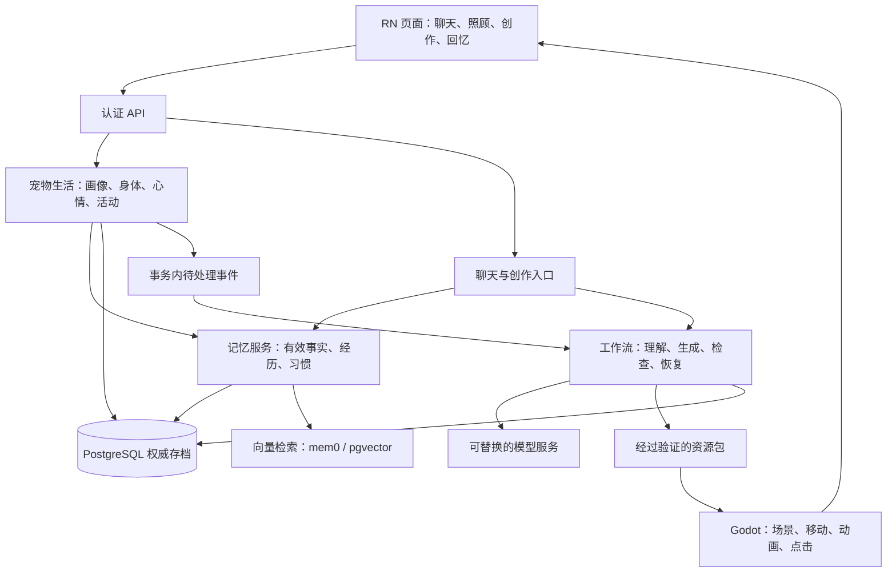
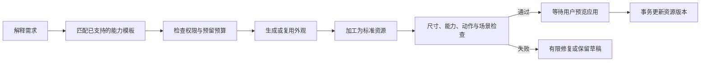

# 丸宠技术设计重构方案

> 本文件为重构方案。2026-10-29 后续实现进度见 [第一轮实现说明](04-implementation.md)，不应把方案中的目标当成已交付功能。
日期：2026-10-29。状态：设计提案，尚未实施。

建议保留 RN、Godot、NestJS 和 PostgreSQL 的基础，重组宠物生活、场景交互、记忆和内容制作。先用小样确定画面路线，再分段替换旧代码。

本篇前半部分解释为什么画面割裂、为什么功能接不上；后半部分给出开发目录、数据关系、skill / LangGraph 工作流与迁移顺序。产品与交互分别见[产品方案](01-product-design.md)、[功能方案](02-functional-design.md)。

几个技术词可以直接这样理解：**事务**是几项变化一起成功或一起撤回；**幂等**是同一请求重发仍只算一次；**租约**是有时限的执行权；**检查点**是任务做到哪一步的存档；**向量检索**是按意思查找相关记忆；**骨骼**是带动模型身体运动的一组控制点。

## 1. 本次调查的依据与限制

检查对象是 `wanpet-app` 当前工作区。分支为 `main`，HEAD 为 `93ba9f5`，存在大量原有修改和未跟踪文件，因此本报告依据工作区源码，不能把该提交号当成完整当前版本。本轮只新增本目录的三份文档，未提交、推送、迁移数据库或部署。线上实际运行版本未核验。

当前主客户端是 React Native 0.81.0 + `@borndotcom/react-native-godot` 1.0.1；移动端导入器固定 Godot 4.5.1。仓库另保留 Godot 4.7.2 独立客户端、React/PixiJS 旧预览。它们不能混在一起当成同一套运行证据。

阅读了 RN 首页、聊天与会话模块，Godot 场景、宠物、行为控制器和资源配置，后端生活、聊天、记忆、图片、旅行、数据库模型，以及现有美术和视频处理记录。旧文档存在滞后，例如根 `PRODUCT.md` 仍描述 Web，早期比例审计说对象数组为空，而当前房间配置已经加入猫窝和食盆。以下以源码为准。

看过本机已有进食、睡眠截图：猫与窝的叠放和道具位置值得重新制作。这些是既有产物，不是本轮重新录制的动作视频，不能用来证明当前真机帧率或所有动作都出错。

## 2. 图层问题的具体原因

### 2.1 已确认的代码事实

| 事实与位置 | 对体验的影响 | 应怎样改 |
| --- | --- | --- |
| `room.gd:31,35`：背景在 `z=-10`，世界节点已启用按 Y 排序 | 已有前后排序，问题不能简单归因为“没开图层排序” | 同时处理场景结构、遮挡、尺度和接触 |
| `morning-interior.json`：大部分家具在背景图里，独立对象只有猫窝和食盆 | 桌子、植物等不能作为独立物件避让或遮挡 | 可交互家具从背景拆出；装饰背景只保留远处内容 |
| `room.gd:117–121` 与房间配置：窝在 `ground`，碗在 `world` | 窝整体永远在猫后面；仅按一个位置排序无法表现窝沿包住猫 | 2D 拆前后部件/遮罩；3D 使用真实几何 |
| `morning-interior.json`：食物目标点是 `[245,659]`，碗的位置是 `[270,668]` | 只规定去哪里站，没有嘴、碗口、朝向的共同约定 | 为物件增加靠近点、站位、朝向和身体接触点 |
| `cat_life.gd:_start()`：吃饭等活动固定使用 `facing=front` | 调整家具位置后，动作不能自动朝向家具 | 由使用位置决定面向；动画需要支持相应方向 |
| `morning-pet.json`：不同动作族使用不同固定倍率，明确写着过渡端点不匹配 | 已有校准只能缓解，不能把不同视频中的身体变成同一套身体 | 建立统一身体、骨骼和动作资产规范 |
| `pet.gd:84,170`：当前资源启用 `crossfade`，绕过可见起身/趴下 | 淡入淡出会出现姿态交接，不能替代实际起身动作 | 用真实过渡动作；骨骼动画才能合理混合姿态 |
| `pet.gd:35`：碰撞圆半径 7；房间导航半径 8，而猫可见宽度约 190 | 脚底可走不代表大幅伸出的身体一定不会盖住家具 | 设计合适的地面占用、身体余量与遮挡；不直接把整张图片当碰撞盒 |

两张房间配置的脚底可行区域都很小。室内范围约 148×122 个逻辑单位，实际多边形占 390×844 画布的约 4.8%；庭院约 4.7%。这里是**画布面积比例，不是可见地板比例**。这解释了目前很多“自由活动”实际发生在前景一小块区域。

这些事实足以确定重构方向，但尚未逐帧测量所有穿插和步态问题。不能把所有僵硬归因于视频抽帧，也不能把未测量的掉帧当成已确认原因。

### 2.2 图层、碰撞和接触是三件不同的事

**图层决定谁挡住谁。碰撞决定能不能走过去。接触决定嘴、脚或爪子该放在哪里。** 三者缺一，画面都可能不自然。

例如猫进窝：地面碰撞要允许进入窝内；窝后沿在猫后面；前沿挡住身体下部；猫的身体还要适合窝的尺寸。只把猫整体放到窝前面或后面，都不够。

Godot 的 2D CanvasItem 提供树顺序、Z 顺序与 Y 排序等机制，但不会理解插画里哪个像素是桌腿。这些物件关系仍要由项目建立。[Godot 4.5 CanvasItem 文档](https://docs.godotengine.org/en/4.5/classes/class_canvasitem.html)

### 2.3 当前测试为什么没发现

现有 `apps/godot/tests/cat_life.gd` 检查：目标可达、走到位置附近、开始与完成回执、重复意图、邀请、减少动态和离线回退。它没有检查嘴到食物的距离、窝沿遮挡、身体轮廓连续性或真实帧时间。

所以“代码测试通过”和“看上去像在真实生活”是两套验收，后续必须同时保留。

## 3. 画面技术路线的选择

| 路线 | 好处 | 代价与适合范围 |
| --- | --- | --- |
| 继续独立视频抽帧 | 能复用现有猫；单段动作有手绘质感 | 每个方向、动作、宠物都需要一致素材；动态对齐与自由摆放难，纹理量随内容增加 |
| 规范化 2D 分层 + 骨骼/手绘动画 | 最接近现有画风，可重做遮挡、站位和动作 | 转身、复杂四足动作、不同体形仍需要大量制作；适合有限视角和活动 |
| 固定视角手绘风 3D | 身体、家具共用空间；尺寸、朝向、接触和换装更容易统一 | 需要建模、骨骼、动作、美术调校和手机性能验证 |

**优先验证第三条。** 这里的“2.5D 观感”指内部为 3D，使用固定、稍俯视的镜头和手绘材质呈现；不是把三张平面图放到不同 Z 位置。

继续使用 Godot，不为了某个 Three.js skill 改成浏览器引擎。RN 负责输入、账号和业务面板；Godot 独立负责完整场景。Godot 的 AnimationTree 可组织二维或三维动画过渡，但它不能自动修复互不一致的视频图像。[AnimationTree 官方说明](https://docs.godotengine.org/en/4.5/tutorials/animation/animation_tree.html)

### 3.1 切换前必须完成的小样

同一只猫，一个房间，碗、床、猫砂盆三个设施。连续演示：走过去 → 转身就位 → 吃饭 → 离开 → 进窝 → 起床 → 使用厕所。随后更换碗的位置与大小，再跑一遍。

| 验收点 | 初始目标，需在目标设备确认 |
| --- | --- |
| 身体连续 | 不通过忽大忽小或透明度切换掩盖身体跳变 |
| 接触 | 嘴到食物、脚到地面、身体到窝的误差可测；样例按身体尺寸归一化，接触误差目标不超过体长的 2% |
| 遮挡 | 同一路径前后经过家具；床沿、植物不出现明显错误覆盖 |
| 帧时间 | 基准设备连续运行 15 分钟，95% 帧不超过 33.3ms；高档位再争取 60fps |
| 稳定性 | 切房间、后台恢复、开聊天键盘不重复创建引擎或丢失活动 |
| 美术 | 保留柔和手绘感，近景和远景都可接受；不以低模占位当最终效果 |

原型开始时登记一台较旧 iPhone 和一台中档 Android 的具体型号。以上是拟定门槛，不是已测数据。原型失败先判断是素材、绑定、引擎集成还是性能问题；若3D路线不成立，转为第二条，保留同一套业务协议。

### 3.2 统一空间与尺寸

在 3D 方案中约定 1 个世界单位等于 1 米，Godot 使用 Y 向上。原型默认固定正交相机；宠物、家具和房间都按同一套相机设计，避免在模型中烘焙互相矛盾的透视。

举例：猫身长 0.45、碗直径 0.16、窝宽 0.60，均是原型尺寸，不是对所有物种的硬限制。先确定身体尺寸，再计算合适设施；禁止为每个动作单独重新缩放宠物。

每个可互动物件定义：

- 外形与地面占用：画出来多大、地面挡住哪里。
- 靠近点：走到哪个位置开始准备动作。
- 使用位置：脚、身体和面向应该怎样摆。
- 接触点：食物表面、床面、书页等实际目标。
- 可用能力：吃饭、睡觉、阅读等经过验证的活动。

移动的位移只由一个控制器负责。动作播放速度与实际行走速度匹配，避免动画自己向前走、导航又把猫推一次。用骨骼校正头部和脚部接触；超出允许身体范围就重新站位，不能把头拉长去够食盆。

3D 也会穿模，透明材质也可能排序错误。需要合适碰撞、接触约束和材质，不能把“转 3D”当成自动修复按钮。

若采用 2D 回退，统一脚底锚点和画面比例，重要家具拆成前后部件，必要时使用遮罩；嘴与爪子接触点随动作记录，限定允许的家具方向。不能仅补一个 `z_index` 就宣称完成。

## 4. 功能接不上的原因

| 当前结构 | 缺口 | 重构方向 |
| --- | --- | --- |
| `Pet` 只有身份基础字段，`PetLife.state` 内含性格与需求 | 没有一份独立画像同时服务聊天、行动、生成 | 明确 PetProfile，保持宠物 ID 不变 |
| `cat-life.ts` 用固定七种活动、四个地点 | 添加如厕、阅读、新设施需改多处枚举和条件 | 活动模板 + 物件能力 + 身体能力校验 |
| `jev.ts:43–45` 只读生活状态和最近六次活动，并固定“真实家猫” | 自主行为不读聊天长期记忆，无法统一轻拟人角色 | 用统一的画像和记忆服务组织相关上下文 |
| `chat-service.ts:167` 有意去掉生活记忆，避免忘记后重新学回 | 直接把生活记录塞回聊天会破坏现有删除语义 | 统一经历来源和忘记规则，再开放双方读取 |
| `satisfy()` 直接降低饥饿；食物描述是自由供应 | 吃饭没有与碗、库存、排泄串起来 | 所有影响状态的活动通过统一执行服务 |
| `ImageJob` 关联聊天轮次或旅行 | 通用宠物/场景/道具制作缺少多步骤任务和验收 | 扩展通用创作任务，复用现有预算与不确定结果机制 |
| RN 热点坐标与 Godot 房间分别配置 | 换背景、改布局后容易出现点的位置与物件错开 | 物件归场景管理；RN 接收物件事件，固定业务控件独立布局 |

当前聊天已经通过动作邀请接入生活服务，因此不能说所有功能完全孤立。缺少的是统一的状态、能力和事件结构。

## 5. 目标架构，用简单的分工理解



先保持一个有清晰模块的后端，耗时任务放在工作进程中。没有证据需要立即拆成大量微服务。一个模块要清楚负责什么，比多建几个服务更重要。

### 5.1 谁负责最终结果

| 部分 | 有权决定 | 无权决定 |
| --- | --- | --- |
| PostgreSQL 与业务服务 | 宠物状态、物品消耗、完成结果、有效记忆、资源应用版本 | 模型没完成的事不能算完成 |
| 行为选择器 | 在允许活动里选择想做什么 | 不能绕过身体、物品、位置限制 |
| LLM | 理解、选择建议、自然回复、创作描述 | 不直接改数据库数值、不决定奖励、不执行生成的任意脚本 |
| Godot | 路径、站位、动画、碰撞与可见接触 | 不独立发奖、扣库存或写永久记忆 |
| RN | 展示、输入、生命周期、待确认操作 | 不用设备时钟确认旅行结束或生活结算 |
| mem0 / 向量库 | 提炼和寻找相关记忆候选 | 不能覆盖业务数据库中的删除、归属和有效性规则 |

## 6. 代码应怎样拆，哪些保留

以下是目标目录建议，不是本轮已创建的模块。

```text
apps/mobile/src/
  features/home/          家园入口与轻量工具栏
  features/chat/          对话、语音、动作进度
  features/care/          食物、清理、身体状态
  features/creation/      创作任务与预览
  features/memories/      画像、经历与记忆管理
  game/                  RN 与 Godot 桥接
  session/               账号、网络、待确认操作

apps/godot/
  world/                 房间、物件、导航、接触位置
  pets/                  身体、表情、动画驱动
  activities/            移动、就位、使用、结束表现
  bridge/                收快照、发物件与执行事件

apps/server/src/
  identity/              保留现有认证与归属校验
  pets/                  画像、身体与心情
  activities/            选择、预留、执行、结算
  worlds/                物件、布局、可用能力
  memories/              来源、检索、纠正、忘记
  chat/                  上下文、回复、工具入口
  creation/              通用创作任务、预算、资源版本
  workflows/             LangGraph 流程与持久恢复
  providers/             文本、图像、3D、语音适配
  travel/                保留旅行事务并输出经历事件

packages/contracts/      API、场景桥接和资源清单协议
packages/game-core/      确定性需求变化、规则和公共数据定义
```

先从现有文件抽出职责，保持旧入口可用，再逐个替换调用方。不要一次搬目录、换接口、换引擎和换数据库结构。

| 现有内容 | 处理建议 |
| --- | --- |
| `service.ts` 的认证、账号锁、幂等记录、旅行账本 | 保留并逐步拆模块，继续作为权威写入基础 |
| `Session.ts` 的待确认写入与账号隔离 | 保留；新增宠物和活动版本，延用同键核对 |
| `chat-service.ts`、`memory-*` | 拆出公共记忆服务；保留纠正/删除的上下文版本保护 |
| `image-service.ts`、`image-store.ts`、`seedream.ts` | 保留已有图片能力；通用制作流程调用它们，不重复造一套收费机制 |
| `cat-life.ts` | 逐步成为物种无关的生活规则；参数来自身体模板与画像 |
| `cat_life.gd`、`pet.gd` | 拆开活动执行和动画驱动；去掉服务端与客户端重复维护的权威需求变化 |
| `room.gd` 与房间 JSON | 升级为可互动世界；按原型结果选择 3D 或规范化 2D |
| `apps/client`、独立 Godot 业务界面 | 先冻结为历史预览；新功能只进 RN 主链，待迁移稳定后再归档 |
| 原视频、图集和旧艺术资源 | 保留来源；逐步移出正式安装包，只随包带当前需要的资源 |

## 7. 数据关系和执行协议

### 7.1 在现有模型上增量扩展

| 数据 | 实现建议 |
| --- | --- |
| PetProfile | 新增一对一画像；保存基础性格、交流风格、身体模板、外观版本和画像版本 |
| PetLife | 从当前 JSON v1 迁移到明确版本的新状态；保存身体、心情、最后推进时间和活动引用 |
| LongMemory | 扩展现有表：类别、来源事件、有效性、置信度、纠正关系与忘记状态；不另造两套长期记忆真相 |
| PetEvent | 新增可信经历：发生了什么、何时、关联活动与物件、是否离线补算 |
| ActivityExecution | 保存活动步骤、目标、预留、进度、结果、租约和版本 |
| WorldInstance / WorldObject | 保存家园版本、物件位置、状态、资源版本与使用位置 |
| CreationJob / AssetVersion | 通用制作任务与可回滚资源版本；现有 ImageJob 可先作为图像步骤的子任务 |
| Outbox | 与业务变化一起落库的待处理事件，用于记忆整理和生成任务；消费者按事件 ID 去重 |

现在 `Pet.playerId` 有唯一约束，`Trip` 主要关联玩家。多宠开放前需要将玩家关系改为一对多、给旅程补宠物 ID，并调整“同一未领取旅程”的约束范围；不能只在首页增加切宠按钮。首轮迁移保留原宠物 ID，避免聊天、记忆、图片引用失联。

### 7.2 一次进食的服务端流程

1. 读取宠物、世界和画像版本，推进必要的身体状态。
2. 在事务外选择活动；模型慢或失败时使用规则。
3. 进入事务，重新核对版本、归属、所在地、碗和食物；预留一份并创建活动。
4. Godot 收到活动，寻路、就位，报告“进入进食阶段”。
5. 服务端验证阶段顺序、最短时间、目标物件版本与执行权，确认实际消耗。
6. 完成后在一个事务里更新身体、物件、经历和待处理事件。
7. 记忆流程异步读取这次可信经历，按重要性决定是否记住。

客户端回执是执行报告，不能单独证明可信结果。服务端必须验证时间、预留、版本和阶段；失败回执也不能重复退粮。模型调用不能占着数据库锁等待。

每只宠物同一时刻只允许一个占用身体的主要活动。使用服务端租约标记当前哪台设备可推进表现，并附递增执行令牌；旧设备失联后再上报，不得覆盖新状态。旁白和简单表情可以并行，但不能同时吃饭和远行。

### 7.3 建议的接口与桥接信息

以下是新协议草案，实施时先更新 `packages/contracts` 与输入校验，再改服务端和 UI。

| 用途 | 草案 |
| --- | --- |
| 读取统一宠物视图 | `GET /v1/me/pets/:petId`，含画像摘要、身体、心情、活动和版本 |
| 邀请活动 | `POST /v1/me/pets/:petId/invitations`，只允许活动 ID、目标物件 ID与预期版本 |
| 补粮、清理等 | `POST /v1/me/worlds/:worldId/commands`，服务端校验支持的命令与物件 |
| 创作 | `POST /v1/me/creations`，返回持久任务 ID；之后查询、取消、预览应用 |
| 执行进度 | `POST /v1/me/pets/:petId/activities/:id/events`，带执行令牌、顺序号、阶段和物件版本 |

所有写入继续要求认证、输入校验和重发只算一次的幂等键。路径中的宠物 ID 只是请求目标，服务端仍要核对主人，不能当成身份凭证。

RN ↔ Godot 只传低频快照、活动命令和事件。字段至少包含协议版本、宠物 ID、世界版本、活动 ID、执行令牌和事件序号。桥接边界需要运行时校验，不能只依赖 TypeScript 类型。

场景负责物件点击与世界坐标。RN 不再另写一份家具热区；需要显示物件菜单时，Godot 回传物件 ID 和屏幕位置。固定工具栏仍由 RN 控制，不把每帧坐标送进 React 状态。加载时可以显示静态海报，场景就绪后整套世界由 Godot 绘制。

### 7.4 离线生活与时间推进

服务端保存最后推进时间，使用服务器时间计算经过多久。离线期间按有限的活动段推进身体与照料，不回放每一帧，也不补发成百上千次模型调用。初版上限可以沿用当前思路，再由体验测试确定。

关闭应用时，未开始使用的物品预留到期释放；已经消耗的部分保留。重新连接后，由服务端依据活动阶段、时间和物件状态，决定继续、补算完成或中断；同一活动只产生一份结果。客户端本地待机不能凭动画完成补写一条真实经历。

每次补算和设备接管都更新版本，并在同一事务里处理过期活动、物品预留和新状态。RN 恢复后先核对未确认操作，再获取新快照。减少动态只换表现方式，不能关闭服务端生活推进。

### 7.5 新活动如何扩展

下面是“阅读”活动定义的示意，不是可直接加载的现有配置：

```yaml
id: read_book
version: 1
requires:
  pet_capabilities: [sit, look_at, read_pose]
  object_capability: readable
  interaction_slot: reading
steps: [reserve_slot, navigate, align, read_loop, release_slot]
completion_event: book_read
result_rule: reading_v1
interruption_rule: stop_without_completion
```

各步骤引用程序中已经实现并验证的动作；模型不能填写任意脚本。“换一本书”只换内容和资源；“新增阅读方式”需要补齐动画、结果规则和测试，再发布一个模板版本。接口和界面从能力清单读取可用项，减少前后端散落多份动作枚举。

模板声明的能力还要和当前宠物、物件资源包交叉核对。只有服务器和客户端都支持同一模板版本，才允许启动；资源不匹配时显示不可用原因，不回退成一段与活动无关的趴卧动画。

## 8. 让聊天和自主生活共享记忆

建立一个公共“宠物上下文服务”，输出当前画像版本、状态版本、有效记忆与可用活动。聊天请求和行为请求按不同用途取内容，但归属和删除规则相同。

检索顺序建议为：先取身份、当前状态与明确相关事实，再取少量相关经历，最后取习惯摘要。不要把全部聊天、全部生活记录塞进提示词。具体位置、食物余量和活动进度直接读业务状态，不能靠语义检索。

保留现有 `petId:epoch` 隔离思路，并扩展到画像摘要、行为缓存和工作流。删除或纠正记忆后递增上下文版本，旧版本的生成、提炼和行动建议在提交前全部重新检查；向量命中后还要回查业务条目是否有效。

派生习惯保存来源事件。用户要求忘记相关内容时，重新计算受影响的习惯，并阻止旧来源再次被提炼。旧检查点可以为运维保留必要的执行元数据，但不能继续把已删除私人内容注入模型；含内容的历史状态需要相应清理策略。

mem0 可以先保留。先修业务层的来源和有效性，不为了换记忆框架整体重写。LangGraph 的检查点用于恢复某次任务，长期记忆仍需要独立存储与规则；二者不能混为一谈。[LangGraph 持久化说明](https://docs.langchain.com/oss/javascript/langgraph/persistence)、[记忆概念](https://docs.langchain.com/oss/javascript/concepts/memory)

## 9. Codex SOP 怎样封装成 skill 与工作流

### 9.1 两者分别做什么

**skill 是制作说明书。** 给开发代理说明输入、步骤、允许使用的工具、输出和验收。适合在开发阶段制作一套宠物、道具或动作。

**workflow 是程序运行的流程。** 玩家点“生成蓝碗”后，它负责排队、调用模型、保存阶段、恢复失败、控制费用和提供预览。它必须能在服务重启后继续。

两者复用相同的制作脚本和检查标准。不要让玩家触发的通用生成代理获得终端或任意代码执行能力。新玩法只能组合已经注册的能力；新代码由开发流程审核、测试、发布。

### 9.2 将现有制作过程整理成项目技能

建议后续创建以下项目技能；本轮只定义职责，没有安装或创建可执行技能。

| 拟定技能 | 输入 | 输出与过关条件 | 复用基础 |
| --- | --- | --- | --- |
| `wanpet-art-direction` | 角色/场景参考、主题、用途 | 风格表、统一镜头/光线/尺寸要求、正侧背参考 | `docs/art-direction.md`、已有提示词和来源记录 |
| `wanpet-pet-build` | 角色参考、身体模板、所需动作 | 宠物资源包、身份花纹检查、动作与接触检查 | 当前 pet 配置、比例审计、动作测试 |
| `wanpet-world-build` | 房间模板、家具清单、主题 | 可通行场景、物件使用位置、正确前后关系 | 房间 JSON、导航与场景测试 |
| `wanpet-activity-build` | “看书”等目标、支持身体、相关物件 | 活动定义、动画、阶段结果、受阻与打断测试 | 现有生活控制器与后端活动规则 |
| `wanpet-video-import` | 已授权视频与固定角色参考 | 抠像、锚点、图集、连续性报告；用于兼容和素材制作 | `seedance-cat-video.py`、`key-cat-video.py`、`pack-video-*.py` |
| `wanpet-content-qa` | 宠物 + 房间 + 道具的最终组合 | 接触、遮挡、尺寸、帧时间、来源和包体报告 | 当前 Godot/RN 测试和资源 manifest |

每个技能使用固定结构：`SKILL.md` 写使用条件；`references/` 写规范；`scripts/` 放可重复执行的步骤；`examples/` 放一个通过验收的样例。输出必须含制作参数、源素材、模型版本、文件哈希和检查结果，避免下一次又从聊天记录手工寻找流程。

现有 Python 视频脚本中有针对目录、猫资源和图集尺寸的约定。封装时先把输入输出参数化，并分开“生成付费任务”“查询已有任务”“下载”“加工”“验证”，不能直接把一串会改 manifest 的旧命令包成黑盒。

### 9.3 LangGraph 运行工作流

优先使用 TypeScript 版本，复用当前 Node 后端；需要 Blender 或图像加工时由隔离制作进程执行受控工具。先做一个通用道具生成流程，再推广到宠物与场景。



再增加两类流程：

- **宠物对话**：读取有效上下文 → 生成回复/活动邀请 → 验证工具请求 → 发布实际结果。实时活动由专门服务继续推进，图流程不等待几十秒动画播放。
- **记忆整理**：读取可信事件 → 筛选重要内容 → 提炼与去重 → 检查上下文版本 → 写业务条目 → 更新检索索引。任务失败不阻塞吃饭或聊天。

工作流保存任务 ID、当前步骤、模板/模型版本、输入引用、产物引用、外部任务 ID、费用预留和上下文版本。PostgreSQL 保存检查点；图片和模型放资源存储，不把二进制或密钥塞进图状态。

生成步骤的唯一编号可由“创作任务 + 步骤 + 显式尝试次数”组成。节点重跑先查已有结果或供应商任务，不能自动重新提交付费生成。外部请求已发出但结果不明时保留 `unknown` 并核对；检查点本身不能保证外部服务绝不重复收费。[LangGraph 中断与重入约束](https://docs.langchain.com/oss/javascript/langgraph/interrupts)

失败重试、超时和恢复按节点设置；读取和下载可有限重试，付费生成必须区分明确失败与结果不明。LangGraph 提供相关机制，但业务仍需自己定义重试边界。[LangGraph 容错文档](https://docs.langchain.com/oss/javascript/langgraph/fault-tolerance)

当前 API 中已有进程内运行标记、限流和单实例记忆维护约定。扩容前要增加持久任务抢占、租约、过期接管与共享额度；不能只启动第二个服务副本。先用 PostgreSQL 的事务和租约即可，暂不强制增加 Redis。

## 10. 资源生成如何真正落地

### 10.1 标准资源包

一个资源包包含外观文件和一份清单，清单说明：稳定 ID、版本、资源类型、身体模板、物理尺寸、朝向、碰撞、使用位置、支持动作、文件哈希、来源与权利状态、性能检查结果。

宠物额外包含统一骨骼约定和动作清单；道具额外包含可用能力；场景额外包含布局、通道和可替换主题区域。文件格式正确只代表能读，必须放入实际场景检查才算可用。

3D 资源优先采用 glTF/GLB，验证坐标、材质、骨骼和动画的导入结果。运行时下载的资源走受控加载与白名单资源类型，不接受模型生成的脚本或任意 `.pck` 执行包。[Godot 支持的 3D 格式](https://docs.godotengine.org/en/4.5/tutorials/assets_pipeline/importing_3d_scenes/available_formats.html)

### 10.2 宠物、家具与房间各自的生成路径

**宠物**：角色参考 → 体形与花纹确认 → 基础网格/模板 → 材质 → 骨骼 → 动作适配 → 接触检查 → 游戏内预览。首期用已经验收的猫身体模板生成变体；完全新物种必须补动作与设施适配。

**家具**：用途模板 → 生成外观/模型 → 统一尺寸与原点 → 添加碰撞和使用位置 → 放进测试房间 → 实际使用。只靠模型看起来像碗，不能认定它能被吃饭活动使用。

**房间**：已验证空间模板 → 生成墙地材质、窗景、局部装饰 → 摆放标准家具 → 验证路径与可用位置 → 保存新版本。生成一整张漂亮图片可以作为概念稿，不能直接承诺变成可自由走动的房间。

Tripo 官方提供四足等类型的绑定及预检查，可作为原型候选；它能自动绑定不代表已经拥有吃饭、如厕、读书的完整猫动作。不同身体要先检查，再验证实际动作。[Tripo Rigging](https://developers.tripo3d.com/en/models/rig)、[Pre rig check](https://docs.tripo3d.ai/animation/pre-rig-check-v2-0-20250506.html)

Hunyuan3D-2.1 可作为自托管生成网格与材质的候选，但要承担 GPU、模型部署和资产后处理；公开模型也不等于自动获得适合手机的完整动画角色。[Hunyuan3D 官方仓库](https://github.com/Tencent-Hunyuan/Hunyuan3D-2.1)

### 10.3 发布、权限与成本

资源完成检查后先进入预览，再原子地更新当前引用；失败时旧版本保持可用。客户端按哈希缓存，更新中途退出不会混用半套新旧资源。

私人照片、聊天生图、宠物专属作品与系统共享明信片继续分开。只有用途和权限明确允许的内容才能进入共享资源池。删除或撤销访问时，任务、缓存与后续引用一起处理。

计费复用当前“预留、确定已消耗、明确未收费释放、结果不明待核对”的思路，扩展到每种制作步骤。图片重下载与再次生成是两个操作，不能混在同一个“重试”按钮里。

模型适配器按能力划分：文本/结构化输出、图片编辑、3D 生成、骨骼处理、语音。先继续使用项目已有且能验证的供应商，通过相同样例比较质量、时延、成功率和费用，再换模型；不把某个当前型号写死到业务规则。当前代码出现的 Jev、Haiku、Seedream 名称只是实现配置，本轮没有重新验证其线上可用性或价格。

## 11. 网上技能的筛选结果

检索与阅读日期为 2026-10-29。下面区分技能、模型与运行框架；本轮未安装外部技能、MCP 或付费制作服务。

| 来源 | 能帮什么 | 本项目怎么用与限制 |
| --- | --- | --- |
| [haxqer/godot-skill](https://github.com/haxqer/godot-skill/blob/main/skill/godot/SKILL.md) | 场景、状态机、资源、寻路、导出与验证流程 | 已读取技能正文，可借鉴验收组织；上游标注主要验证 4.7，项目移动端是 4.5.1，不能照搬所有 API |
| [Impeccable](https://github.com/pbakaus/impeccable) | UI 层次、交互规划、设计检查与一致性 | 本机已有，本轮用于规划；原生界面须按 RN / iOS / Android 验收，不能用网页检测替代 |
| [OpenAI imagegen](https://github.com/openai/skills/blob/main/skills/.system/imagegen/SKILL.md) | 角色参考、场景概念、道具外观与图像编辑 | 本机已有；适合制作阶段，不等于玩家端的生成服务，也不保证动作和空间一致 |
| [RobLe3 blender-modeling](https://github.com/RobLe3/cc-blender-skill/blob/main/plugin/skills/blender-modeling/SKILL.md) | 家具建模、几何加工、尺寸与结构修正 | 已读取正文；依赖相应 Blender 工具，适合作为受控制作流程候选，不直接开放给玩家 |
| 本机 `threejs-3d-generator` | Tripo 的生成、绑定、动作检查流程 | 已阅读作为候选；可借鉴资产标准，输出 GLB 后另做 Godot 适配，不引入 Three.js 客户端 |

采用顺序：现有 Impeccable / imagegen → 整理项目自己的验收技能 → 按原型需要引入 Godot / Blender 制作流程。外部技能在复制或执行前锁定审阅提交，核对配套脚本、许可证与版本；这里的“已阅读”不等于完成整套供应链审计。

不要从已有旧调研继续沿用 PixiJS / Capacitor 为当前主技术栈。也不需要因为技能名字里有游戏、3D 或 AI，就安装整套工具集合。

## 12. 按可回退的小步骤迁移

| 顺序 | 改什么 | 交付与回退方式 |
| --- | --- | --- |
| 0 | 固定现有基线 | 记录工作区与资源哈希，整理已通过/待验收场景；不清理用户原有修改 |
| 1 | 统一协议与身份 | 添加画像、活动、世界协议及输入校验；保持旧宠物 ID和旧接口适配 |
| 2 | 验证画面路线 | 完成一个3D样例；未通过前不批量替换旧素材或删除2D运行链 |
| 3 | 统一身体与活动 | 接通吃饭、排泄、清理、睡觉；旧生活服务逐宠物切换，禁止新旧同时写状态 |
| 4 | 共用记忆与画像 | 聊天与行为使用同一有效上下文；通过删除、纠正、跨宠物隔离测试 |
| 5 | 重做首页和面板 | 场景事件统一到新入口，保留账号、待确认写入和辅助功能 |
| 6 | 通用创作工作流 | 先跑通蓝碗，再做房间主题、同模板宠物和阅读活动 |
| 7 | 扩展探索与多宠 | 把旅行接入经历；补多宠关系与约束，再开放新物种 |

数据库使用先增加、再回填、最后切换的方式。旧版状态保留快照，新版必须有数据版本；切换后产生的排泄、食物和物件状态不能靠回滚代码直接丢弃。回退时先停止新写入，转换必要状态或暂时只读；旧客户端不能继续按旧“免费吃饭”规则写新存档。

部署前先在隔离测试库演练迁移和恢复。不要因新增记忆结构而清空现有聊天和向量数据。历史素材的归档放在迁移稳定之后，单独评估包体和存储，不与功能重构混成一次删除。

### 12.1 便于其他开发者加入

按可开源、可协作的标准整理工程，但本方案不改变仓库可见性。

- 提供不需要付费模型的本地规则与模拟供应商，用合成宠物、假聊天和小型示例资源跑完整流程。
- 将启动说明区分为应用开发、场景制作和模型制作三条；记录 Node、Godot、原生桥接与资源导入器的匹配版本。
- 提供新增物件、活动和模型供应商各一个完整样例，明确哪些扩展只改数据、哪些必须写代码和测试。
- 代码、模型权重、第三方技能和美术素材分别记录来源与许可状态；没有明确分发条件的内容不放进默认示例包。
- 原始视频和大型制作产物使用独立资源存储或明确的版本管理方式，仓库保留清单与校验信息；不把玩家数据当测试夹具。
- 为场景桥接与资源清单写版本兼容规则。老客户端遇到新能力要能解释并拒绝，不能默默损坏存档。

## 13. 必须增加的验证

| 层面 | 关键检查 |
| --- | --- |
| 生活规则 | 同样的状态、时间和事件得到同样结果；离线推进有上限；情绪变化有边界 |
| 事务与并发 | 两台设备吃最后一份、重复完成、完成时切旅行、清理时中断；只产生一次真实结果 |
| 记忆 | A/B 宠物隔离、纠正生效、删除后旧任务/旧检查点不能复活事实、故障后可重建 |
| 动作 | 真实站位、朝向、嘴与碗、脚与地面、窝沿遮挡；连续动作录屏与接触误差一起看 |
| 生成 | 失败在每个步骤都能恢复；外部结果不明时不自动重付；无效资源无法应用 |
| 交互 | 点物件位置准确；键盘、小屏、文字放大、系统返回、减少动态、断网和切账号 |
| 设备 | 真机冷启动、内存、持续帧时间、发热、后台恢复；历史图集估算不能替代设备测量 |

建立三个固定样例：小猫吃饭与进窝、移动食盆后的再次进食、生成新蓝碗后完成使用。每次改动作、镜头、资源处理或模型版本，都用相同样例做比较。

当前视频资产已有图集压缩与步速匹配工作，应承认这些已有改进。后续检查重点转到身体连续、真实接触、世界物件和端到端结果，避免反复靠调整全局缩放解决局部素材问题。

## 14. 本轮实际验证记录

- 已核对 RN 当前链路使用的脚本、场景和 `morning-*` 配置与 `.tools/rn-game` 准备目录一致；当前引用的 20 项资源哈希一致。
- 准备目录中的 `cat_life.gd` 测试副本与源码不同，因此最终直接运行了当前源码测试，未将旧副本结果代替当前结果。
- Godot 4.5.1 当前源码测试退出码为 0，输出七种室内活动、庭院、单次完成回执、邀请、减少动态、离家和离线回退检查通过。
- 默认日志目录不可写时首次启动崩溃；把日志改到 `/private/tmp` 后能完成。仍有系统 CA 证书读取错误输出。该无网络场景测试没有依赖证书，不把此结果写成“无错误的全套检查通过”。
- 本轮没有运行数据库集成、真实模型、原生完整构建或物理设备测试，也没有制作新的3D样例。新方案的视觉与性能门槛仍需后续验收。

最终测试的复现写法，在仓库根目录运行；脚本使用绝对路径：

```sh
.tools/godot-4.5.1/Godot.app/Contents/MacOS/Godot \
  --headless \
  --log-file /private/tmp/wanpet-design-cat-life-source-20261029.log \
  --path .tools/rn-game \
  --script "$PWD/apps/godot/tests/cat_life.gd"
```

该准备目录必须先与当前源码及资源核对；它不是新克隆仓库即可直接使用的标准环境。后续实施仍按仓库要求执行 scaffold、类型检查、相关单元与数据库集成、构建、原生与真机 QA。

## 15. 后续开发的主要代码入口

| 主题 | 当前入口 |
| --- | --- |
| 首页与家具入口 | [AppShell.tsx](../../apps/mobile/src/AppShell.tsx) |
| 会话与待确认操作 | [Session.ts](../../apps/mobile/src/session/Session.ts) |
| 引擎桥接 | [engine.ts](../../apps/mobile/src/game/engine.ts)、[rn_scene.gd](../../apps/godot/scripts/rn_scene.gd) |
| 场景分层与寻路 | [room.gd](../../apps/godot/scripts/room.gd)、[室内配置](../../apps/godot/data/morning-interior.json) |
| 动画与素材校准 | [pet.gd](../../apps/godot/scripts/pet.gd)、[当前宠物资源包](../../apps/godot/data/morning-pet.json) |
| 行为执行与生活规则 | [cat_life.gd](../../apps/godot/scripts/cat_life.gd)、[cat-life.ts](../../apps/server/src/cat-life.ts)、[cat-life-service.ts](../../apps/server/src/cat-life-service.ts) |
| 模型决策与聊天 | [jev.ts](../../apps/server/src/jev.ts)、[pet-agent.ts](../../apps/server/src/pet-agent.ts)、[chat-service.ts](../../apps/server/src/chat-service.ts) |
| 记忆与制作任务 | [memory-gateway.ts](../../apps/server/src/memory-gateway.ts)、[image-service.ts](../../apps/server/src/image-service.ts) |
| 权威存档与公开协议 | [schema.prisma](../../apps/server/prisma/schema.prisma)、[contracts](../../packages/contracts/src/index.ts) |
| 现有动作回归 | [cat_life.gd 测试](../../apps/godot/tests/cat_life.gd) |

第一项可以实施的工作是：确定统一活动与物件协议，并完成上述小场景原型。它会同时验证画面方向和后续扩展方式，再决定要替换多少旧渲染代码。
